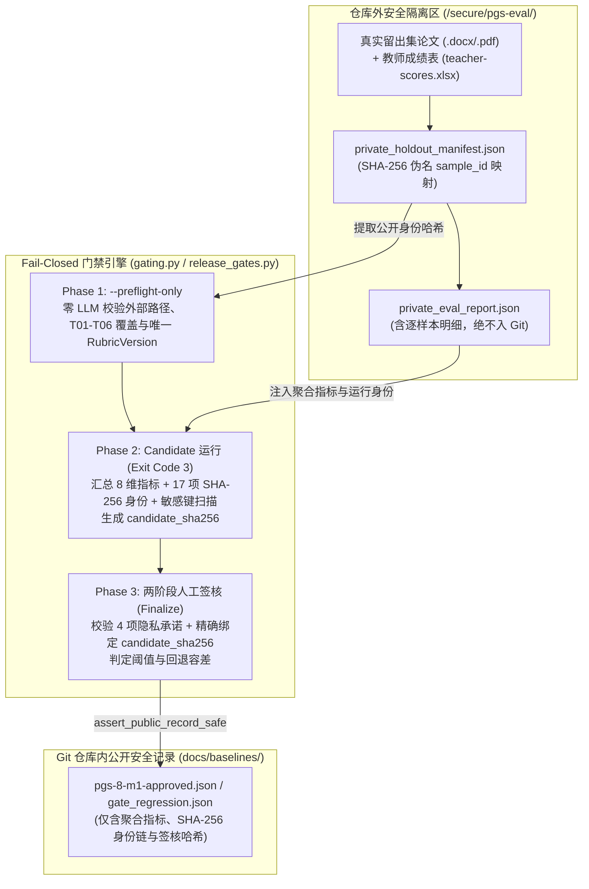
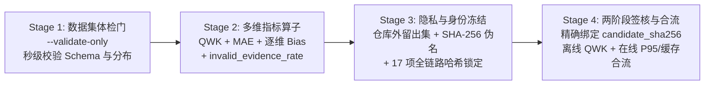

> **导读**：在《[为什么生产级 Agent 必须引入 Temporal 与读写解耦？](/blog/posts/durable-agent-temporal-read-write-decoupling/)》中，我们解决了 Agent 运行时"跑得稳、不重入、高并发"的问题。但对于文档审计、论文评分或风险评估类 Agent 而言，还有一个更致命的问题悬在头顶：**"系统打出的分数，到底准不准、公不公平？"**
>
> 正如我在开源项目 [rubric-audit-engine](https://github.com/liuzhne/rubric-audit-engine) 评测模块开篇写下的那句设计信条——**"复现一个错误的分数毫无意义。"** 当你升级了模型版本、调整了一行 Prompt、修改了切片检索 Top-K，甚至重构了底层评分引擎时，传统单元测试（只测代码不报错）完全无法发现模型尺度的静默漂移。
>
> 本文将结合 [rubric-audit-engine](https://github.com/liuzhne/rubric-audit-engine) 与 [educare-agent-platform](https://github.com/liuzhne/educare-agent-platform) 两个仓库的真实生产代码，从 0 到 1 拆解如何构建一套基于 **QWK（Quadratic Weighted Kappa，二次加权 Kappa）**、具备**全链路密码学身份冻结**与 **Fail-Closed 两阶段人工签核**的 Agent 自动化发布门禁。

---

## 一、为什么 Agent 评测不能只看 Accuracy 或 MAE？

在很多 AI 工程团队的早期实践中，离线评测（Eval）往往止步于抽取几十条样本跑个分，算一下准确率（Exact Agreement）或平均绝对误差（MAE）。但在具有**有序分档（Ordinal Grading）**特征的严肃业务场景中——例如毕业论文与技术方案的五档评定（`不及格 0 / 及格 1 / 中等 2 / 良好 3 / 优秀 4`），或是学生风险预警的四档分级（`none / low / medium / high`）——单一指标会立刻失灵：

1. **普通准确率（Exact Agreement）过于死板，无法区分错误严重度**：
   - 把一篇"良好（3）"的文档评成"优秀（4）"（相邻档微小偏差），和把它评成"不及格（0）"（跨三档灾难性误判），在普通准确率眼里都是 `0` 分。
2. **平均绝对误差（MAE）受总分尺度影响，且掩盖分档边界**：
   - 79 分与 80 分在 MAE 上仅相差 `1.0` 分，但却跨越了"中等"与"良好"的档位边界；反之，若系统对所有样本都保守打出 78~82 分的中庸分数，MAE 看起来会非常漂亮（因为贴近均值），但系统实际上丧失了区分"优秀"与"及格"的判别力（方差坍塌）。

### 1.1 二次加权 Kappa（QWK）的数学原理

为了同时衡量**有序分档的一致性**、**跨档误判的非线性惩罚**并**剔除随机猜中的巧合概率**，自动作文与文档评分领域（如 Kaggle ASAP 竞赛及各类教育测评标准）公认的黄金指标是 **二次加权 Kappa（Quadratic Weighted Kappa, QWK）**。

假设共有 `N` 个有序档位（序数 `i, j ∈ [0, N-1]`），QWK 的计算分为三步：

1. **构建二次惩罚权重矩阵 `W`**：档位差距越大，惩罚呈**平方级**放大：

```text
w[i][j] = (i - j)² / (N - 1)²
```

以五档评分（`N = 5`，分母 `(5 - 1)² = 16`）为例：
- 完全同档（`|i - j| = 0`）：惩罚权重为 `0`
- 相邻差一档（`|i - j| = 1`，如"良好"评为"中等"）：惩罚权重仅为 `1 / 16 = 0.0625`
- 跨两档（`|i - j| = 2`）：惩罚权重跃升为 `4 / 16 = 0.25`
- 跨四档（`|i - j| = 4`，如"优秀"评为"不及格"）：惩罚权重高达 `16 / 16 = 1.0`（相邻档误差的 **16 倍**！）

2. **构建观测矩阵 `O` 与期望矩阵 `E`**：
   - `O[i][j]`：人工真值为第 `i` 档、系统预测为第 `j` 档的实际样本数；
   - `E[i][j]`：在人工与系统各自边缘分布独立假设下的随机期望频数（`hist_true[i] × hist_pred[j] / 样本总数 n`）。
3. **计算归一化一致性系数 `κ`**：

```text
QWK = 1.0 - ( ∑ w[i][j] × O[i][j] ) / ( ∑ w[i][j] × E[i][j] )
```

QWK 的取值范围为 `[-1, 1]`：`1.0` 代表与人类专家完全一致，`0.0` 代表等同于随机盲猜，通常生产级评分引擎要求 `QWK ≥ 0.75 ~ 0.80`。

### 1.2 动态分档与纯函数实现（`backend/app/eval/metrics.py`）

在 [rubric-audit-engine](https://github.com/liuzhne/rubric-audit-engine) 中，不同租户、不同业务 Profile（如满分 100 分的毕业论文 vs. 满分 150 分或按百分比折算的技术方案）拥有各自独立的量规策略（`ScoringPolicy`）。

因此，我们在 `backend/app/eval/metrics.py` 中绝不硬编码 `60/70/80/90` 分档线，而是从已发布 `RubricVersion` 冻结的 `ScoringPolicy` 中动态编译出不可变的 `EvaluationGradeScale`，并使用 `Decimal` 的 `ROUND_HALF_UP` 消除二进制浮点数舍入抖动：

```python
@dataclass(frozen=True, slots=True)
class EvaluationGradeScale:
    """Profile-neutral grade mapping used by QWK and agreement metrics."""

    total_score: str
    basis: str
    bands: tuple[EvaluationGradeBand, ...]
    rounding_mode: str | None = None
    rounding_digits: int | None = None

    def normalize(self, value):
        result = Decimal(str(value))
        if self.rounding_digits is None:
            return result
        if self.rounding_mode != "half_up":
            raise ValueError("evaluation grade scale only supports half_up rounding")
        quantum = Decimal("1").scaleb(-self.rounding_digits)
        return result.quantize(quantum, rounding=ROUND_HALF_UP)

    def ordinal(self, value):
        total = self.normalize(value)
        comparable = total
        if self.basis == "percentage":
            comparable = total / Decimal(self.total_score) * Decimal("100")
        for index, band in enumerate(self.bands):
            if comparable >= Decimal(band.minimum):
                return len(self.bands) - index - 1
        return 0
```

在其之上，`quadratic_weighted_kappa` 被实现为零外部依赖的纯函数，可直接用于毫秒级单元测试与 CI 门禁计算：

```python
def quadratic_weighted_kappa(y_true, y_pred, min_rating=None, max_rating=None):
    """二次加权 Kappa。y_true/y_pred 为整数序数评分（如等级 0..4）。
    返回 -1..1；None 表示样本为空。完全一致=1，等于随机=0。"""
    if len(y_true) != len(y_pred):
        raise ValueError("y_true and y_pred must have the same length")
    if not y_true:
        return None

    true = [int(round(v)) for v in y_true]
    pred = [int(round(v)) for v in y_pred]
    if min_rating is None:
        min_rating = min(min(true), min(pred))
    if max_rating is None:
        max_rating = max(max(true), max(pred))
    num = max_rating - min_rating + 1
    if num <= 1:
        return 1.0

    observed = [[0] * num for _ in range(num)]
    hist_true = [0] * num
    hist_pred = [0] * num
    for a, b in zip(true, pred):
        observed[a - min_rating][b - min_rating] += 1
        hist_true[a - min_rating] += 1
        hist_pred[b - min_rating] += 1

    n = len(true)
    numerator = 0.0
    denominator = 0.0
    for i in range(num):
        for j in range(num):
            weight = ((i - j) ** 2) / ((num - 1) ** 2)
            expected = hist_true[i] * hist_pred[j] / n
            numerator += weight * observed[i][j]
            denominator += weight * expected
    if denominator == 0:
        return 1.0
    return 1.0 - numerator / denominator
```

### 1.3 8 维门禁指标矩阵：防止模型"刷高 QWK 却靠幻觉猜分"

如果只考核总分 QWK，系统很容易陷入另一个工程陷阱：**模型在没有找到原文证据的情况下，靠"印象流"碰巧猜出了接近人类老师的分数。**

为了堵死这条投机路径，`rubric-audit-engine` 在 `backend/app/eval/gating.py` 与 `runner.py` 中定义了 **8 项必检聚合指标（`_AGGREGATE_METRICS`）** + **逐评分项偏差诊断（`_per_criterion_errors`）**：

| 指标类别 | 指标字段名 | 计算方式与门禁方向 | 解决的工程问题 |
| :--- | :--- | :--- | :--- |
| **有序一致性** | `qwk` | 二次加权 Kappa（`≥ minimum_qwk`） | 核心准星：衡量系统分档与专家分档的加权一致性 |
| **连续值误差** | `mae` / `rmse` | 总分平均绝对误差 / 均方根误差（`≤ maximum_mae / rmse`） | 约束分数绝对偏离幅度，RMSE 重点放大极端离群坏案 |
| **分档命中率** | `exact_grade_agreement`<br/>`adjacent_grade_agreement` | 同档一致率 / 相邻档（差 ≤ 1 档）一致率（`≥ minimum_*`） | 直观业务 SLA：例如要求同档 ≥ 60%、相邻档 ≥ 95% |
| **逐维偏宽/偏严诊断** | `per_criterion[code].bias`<br/>`per_criterion[code].mae` | `∑(pred - true) / n`（`> 0` 偏宽，`< 0` 偏严） | 当总分漂移时，精准定位是 `T01` 选题还是 `T03` 论证出了偏差 |
| **运营负载护栏** | `review_rate`<br/>`blocked_rate` | 触发人工复核或自动阻断的样本占比（`≤ maximum_*`） | 防止系统把大量样本全甩给人工复核来逃避自动判分 |
| **抗幻觉证据护栏** | `invalid_evidence_rate` | `evidence_sufficient == False` 的评分项占比（`≤ maximum_invalid_evidence_rate`） | **一票否决项**：即使分数猜得再准，只要引用的原文证据未通过校验，门禁直接拦截！ |

---

## 二、双轨门禁演进：从日常 CI 回归到 PGS-8 生产发布门禁

在实际研发流程中，我们不能每次改一行代码都去走漫长的人工审批，但也不能把日常开发脚本跑出的 JSON 当作生产切换的合法依据。

因此，结合 [educare-agent-platform](https://github.com/liuzhne/educare-agent-platform) 的 `.github/workflows/eval-gate.yml` 与 [rubric-audit-engine](https://github.com/liuzhne/rubric-audit-engine) 的 `run_qwk_eval.py`，我们设计了**双轨递进的门禁体系**：

### 2.1 第一轨：轻量化 CI 回归门禁（Lab Baseline）

在日常 PR 与分支迭代中，门禁追求**快速反馈**：

- **无条件秒级数据集体检（`--validate-only`）**：在 `educare-agent-platform` 的 CI 中，每次修改 `agent-service` 或 `eval/` 都会无条件运行 `python eval/run_eval.py --validate-only`，用纯标准库在 1 秒内校验 50 例标注集的 ID 唯一性、Schema 完整性与标签分布，零外部模型依赖。
- **日常 QWK 基线回归（`assert_no_regression`）**：在 `rubric-audit-engine` 中，开发者运行不带 `--release-gate` 的普通评估时，`runner.py` 会生成一份 `storage/eval/baseline.json` 并按默认容差（QWK 跌幅 `≤ 0.02`、MAE 涨幅 `≤ 1.0`）检查回退。

但请注意 `runner.py` 中 `baseline_from_report()` 的刻意设计：

```python
def baseline_from_report(report):
    """抽取普通实验的聚合基线；它明确不具备发布门禁资格。"""
    keys = ("qwk", "mae", "rmse", "exact_grade_agreement", "adjacent_grade_agreement")
    return {
        "schema": "paper-grading/evaluation-aggregate-baseline@1",
        "provenance": "aggregate_only_non_release",
        "reproducible": False,
        "gating_eligible": False,
        **{key: report.get(key) for key in keys},
    }
```

普通实验基线被硬编码打上了 `"reproducible": False` 与 `"gating_eligible": False` 的烙印——因为它在运行过程中既没有校验 Git 工作树是否干净，也没有锁定模型权重哈希或排除 Few-Shot 锚点泄漏，**绝不能冒充生产发布证据**。

### 2.2 第二轨：Fail-Closed 生产发布门禁（`--release-gate` / PGS-8）

当系统准备发布正式版本（如 M1 真实教师留出集验收、M5 引擎对齐，或 M8 将默认引擎从 `legacy` 切换为 `AtomicRule Core` 的 `GATE-03`）时，必须开启 `--release-gate` 严格门禁模式。

| 对比维度 | 普通实验模式（Lab Baseline） | 生产发布门禁模式（`--release-gate` / PGS-8） |
| :--- | :--- | :--- |
| **数据与路径隔离** | 允许使用测试库或本地目录 | 论文、成绩表、SQLite、模型制品与私有报告**强制位于 Git 仓库外部** |
| **模型与环境要求** | 允许回退 Mock 或滚动模型别名 | 严禁 `mock`、严禁 `LLM_FALLBACK_TO_MOCK`、严禁 `latest` 等滚动别名 |
| **身份可复现性** | 仅记录聚合指标（`reproducible=false`） | 锁定 **17 项 SHA-256 哈希**与 **12 项运行时身份**，工作树必须 `dirty=false` |
| **校准锚点防泄漏** | 不做强制交集校验 | 强制验证 `anchors_identity.holdout_exclusion_proven=true` |
| **通过判定机制** | 默认固定容差自动比对 | **两阶段人工签核**：先以退出码 `3` 挂起生成 `candidate_sha256`，经批准人绑定精确哈希后离线 Finalize |

---

## 三、从 0 到 1 拆解 Fail-Closed 发布门禁的四大工程支柱

下面我们深入 [rubric-audit-engine](https://github.com/liuzhne/rubric-audit-engine) 的 `backend/app/eval/gating.py`、`backend/app/scripts/run_qwk_eval.py` 与 `backend/app/services/release_gates.py`，看这套 Fail-Closed 发布门禁是如何一步步构建出来的。



### 支柱一：仓库外留出集物理隔离与单向伪名化脱敏

真实的学生论文、客户技术方案以及人类专家的逐样本打分属于高敏感隐私资产，一旦误提交进 Git 历史，清理代价极高；同时，如果评测集明文躺在代码仓库里，也很容易在研发调试过程中发生针对特定样本的"过拟合调参"。

为此，`gating.py` 在入口处实施了三道铁闸：

1. **物理路径强制外置（`ensure_external_artifact_dir`）**：
   评测脚本在启动时会用 `Path.relative_to(PROJECT_ROOT)` 检查 `--papers-dir`、`--scores`、`--artifact-dir`、数据库文件与本地模型路径。**只要任何一个路径位于 Git 仓库目录树内，脚本立即抛出 `GateValidationError` 拒绝执行。**
2. **基于内容哈希的单向样本伪名化（`sample_id_for_artifact_sha256`）**：
   在构建留出集清单时，系统不会使用学生姓名或原始文件名作为样本标识，而是读取文件字节流计算 `artifact_sha256`，再派生出带领域前缀的单向伪名 `sample_id`：

```python
def sample_id_for_artifact_sha256(artifact_sha256: str) -> str:
    _require_sha256(artifact_sha256, "artifact_sha256")
    payload = ("paper-grading/holdout-sample@1\0" + artifact_sha256).encode("utf-8")
    return hashlib.sha256(payload).hexdigest()
```

同时，`build_holdout_manifest_from_rows` 会严格校验论文文件夹中的 `.docx/.pdf` 与教师成绩表必须 **100% 双向精确覆盖**——既不允许成绩表引用不存在的文档，也不允许目录里混入未登记的冗余文档，且严禁出现重复内容的样本。

3. **递归敏感字段黑名单扫描（`assert_public_record_safe`）**：
   任何准备写入公开门禁记录（`--public-record-output`）或数据库的 JSON，都必须通过 `assert_public_record_safe` 的递归键名扫描。一旦发现以下 14 个敏感字段中的任何一个，立即阻断落盘：

```python
_SENSITIVE_PUBLIC_KEYS = {
    "filename", "file_name", "student_id", "student_name",
    "advisor", "title", "human_total", "human_items",
    "system_total", "system_items", "per_sample", "truth",
}
```

### 支柱二：全链路密码学身份冻结（17 项 SHA-256 哈希锚定）

为什么很多团队的 Agent 评测报告过了一周就无法复现？因为在 LLM 系统中，**代码 Commit 只是决定输出的十几项变量之一**。

在 `gating.py` 的 `build_gate_candidate` 中，我们要求每一个评测样本的持久化运行记录必须携带完全一致的 `_RUN_IDENTITY_FIELDS`，并将全链路 **6 大维度、共 17 项 SHA-256 摘要**全部冻结进候选记录中：

```python
required_hashes = {
    # 1. 数据集与真值身份（证明测的是同一批留出集与同一份教师打分）
    "dataset.dataset_manifest_sha256": dataset_identity.get("dataset_manifest_sha256"),
    "dataset.paper_manifest_sha256": dataset_identity.get("paper_manifest_sha256"),
    "dataset.sample_ids_sha256": dataset_identity.get("sample_ids_sha256"),
    "dataset.truth_sha256": dataset_identity.get("truth_sha256"),

    # 2. 文档解析快照身份（证明 DOCX/PDF 解析器与归一化逻辑未变）
    "documents.document_snapshot_manifest_sha256": run_identity.get("document_snapshot_manifest_sha256"),
    "documents.scored_source_manifest_sha256": run_identity.get("scored_source_manifest_sha256"),

    # 3. 量规、策略、执行计划与确定性检查器身份
    "rubric.version_hash": run_identity.get("rubric_version_hash"),
    "rubric.snapshot_sha256": run_identity.get("rubric_snapshot_hash"),
    "policy.sha256": run_identity.get("policy_hash"),
    "plan.sha256": run_identity.get("execution_plan_hash"),
    "checker.manifest_sha256": run_identity.get("checker_manifest_sha256"),

    # 4. L2 校准锚点身份（含防泄漏证明）
    "anchors.manifest_sha256": anchors_identity.get("manifest_sha256"),

    # 5. 模型制品与 Prompt 源码清单身份
    "model.artifact_identity_sha256": model_identity.get("artifact_identity_sha256"),
    "prompt.source_manifest_sha256": prompt_identity.get("prompt_source_manifest_sha256"),

    # 6. 环境锁文件与外部私有归档身份
    "environment.lockfile_sha256": repository_identity.get("lockfile_sha256"),
    "artifacts.private_manifest_sha256": private_artifacts.get("private_manifest_sha256"),
    "artifacts.private_report_sha256": private_artifacts.get("private_report_sha256"),
}
```

这里有三个极其关键的工程细节：

- **拦截滚动模型别名（`_ROLLING_REVISIONS`）**：在 `services/release_gates.py` 中，如果模型配置使用的是 `latest`、`default`、`stable`、`production` 等滚动别名，或者使用了 `mock` provider，门禁直接拒绝建档。云模型必须声明厂商的不可变快照号（`--immutable-model-revision`），本地模型必须计算 `.gguf` 权重文件的 SHA-256（`--model-artifact`）。
- **防止 Few-Shot 校准锚点污染留出集（Data Leakage Prevention）**：系统支持注入脱敏范文作为 L2 校准锚点（`CalibrationAnchor`）。为了防止有人把留出集里的测试样本塞进锚点库"透题"，门禁强制要求 `anchors_identity.holdout_exclusion_proven = True`。
- **零容忍样本跳过**：门禁强校验 `report["n"] == dataset_size == sample_count` 且 `errors` 为空。只要留出集中有哪怕 1 篇文档解析失败或模型调用报错，候选记录立即判定为 `gating_eligible = False`，绝不允许靠跳过困难样本来美化平均分。

### 支柱三：两阶段人工签核与精确 `candidate_sha256` 绑定

在严肃的生产发布中，**跑出指标（Candidate Generation）**与**批准上线（Maintainer Approval）**必须遵循职责分离原则，且不能由代码私自拍板默认阈值。

因此，`run_qwk_eval.py` 与 `/api/release-gates/` 将门禁流转设计为严格的两阶段协议：

#### 第一阶段：只读预检（`--preflight-only`）与候选生成（退出码 `3`）

在真正消耗昂贵的 LLM Token 之前，数据维护者可以先执行零模型调用的 `--preflight-only` 预检，验证外部数据覆盖率与唯一已发布的 `RubricVersion`。

预检通过后，启动正式候选运行：

```bash
DATABASE_URL=sqlite+pysqlite:////secure/pgs-eval/runtime/eval.sqlite \
STORAGE_ROOT=/secure/pgs-eval/runtime/storage \
LLM_PROVIDER=local \
LLM_FALLBACK_TO_MOCK=false \
LLM_DEBUG_LOG_ENABLED=false \
SCORING_ENGINE_MODE=core \
.venv/bin/python -m backend.app.scripts.run_qwk_eval \
  --release-gate \
  --gate-profile-id '<release-gate-profile-id>' \
  --evaluation-id pgs-8-m1-2026-07-30 \
  --papers-dir /secure/pgs-eval/input/papers \
  --scores /secure/pgs-eval/input/teacher-scores.xlsx \
  --artifact-dir /secure/pgs-eval/archive/pgs-8-2026-07-30 \
  --model-artifact /secure/pgs-eval/input/model.gguf \
  --public-record-output /tmp/pgs-8-candidate.json
```

运行完成后，脚本对整份候选记录计算规范化哈希 `candidate_sha256`（使用 `Decimal` 精确序列化，消除跨平台浮点格式差异），将状态置为 `candidate_awaiting_approval`（固定 `gate_passed = False`），登记到数据库的 `release_gate_runs` 表，并**以状态码 `3` 退出暂停**。

#### 第二阶段：绑定精确 `candidate_sha256` 的防篡改签核（`finalize_gate`）

发布批准人审阅候选报告后，通过 `POST /api/release-gates/runs/{id}/approve`（或离线 `--finalize-candidate`）提交签核。让我们看看 `gating.py` 中 `finalize_gate()` 的核心校验逻辑：

```python
def finalize_gate(candidate: dict, approval: dict) -> dict:
    # 1. 重算并校验 candidate 自身内容未被篡改
    _validate_candidate_hash(candidate)

    # 2. 强制批准文件绑定当前候选的精确 SHA-256（拒绝拿旧批文套新跑分）
    if approval.get("candidate_sha256") != candidate.get("candidate_sha256"):
        raise GateValidationError("approval does not reference this exact candidate")

    # 3. 校验四项隐私与合规承诺必须全部为 True
    privacy = approval.get("privacy_review") or {}
    privacy_requirements = (
        "dataset_deidentified",
        "repository_scan_passed",
        "anchors_exclude_holdout",
        "teacher_truth_external_only",
    )
    failed_privacy = [key for key in privacy_requirements if privacy.get(key) is not True]
    if failed_privacy:
        raise GateValidationError("privacy review is incomplete: %s" % ", ".join(failed_privacy))

    # 4. 校验批准人确认的基线指标与 candidate 实际指标逐项精确相等
    baseline = approval.get("accepted_baseline") or {}
    accepted_metrics = baseline.get("metrics") or {}
    actual_metrics = candidate.get("evaluation", {}).get("metrics") or {}
    for key in _AGGREGATE_METRICS:
        if accepted_metrics.get(key) != actual_metrics.get(key):
            raise GateValidationError("accepted baseline metric %s does not match candidate" % key)

    # 5. 执行 8 项验收阈值与 7 项回退容差校验
    thresholds = baseline.get("acceptance_thresholds") or {}
    tolerances = baseline.get("regression_tolerances") or {}
    threshold_issues = _threshold_issues(actual_metrics, thresholds)
    _validate_regression_tolerances(tolerances)
    ...
```

这种**"内容寻址（Content-Addressed）+ 精确哈希绑定"**的设计意味着：哪怕有人在本地重跑了一次脚本、得到了完全相同的 QWK 分数，只要生成时间戳或任何一项底层哈希发生了变化，`candidate_sha256` 就会改变，旧的 `approval.json` 就会立刻失效报错。只有同时满足 `reproducible=true`、`gating_eligible=true`、`gate_passed=true` 且生成最终 `final_record_sha256` 的记录，才能成为合法的发布基线。

### 支柱四：跨版本回归审计与 `GATE-03` 生产切换证据链

一旦首版真实基线（`GATE-01`）完成签核入库，后续的每一次架构演进（例如修改 Prompt、切换模型或将评分引擎从 `legacy` 升级到 `AtomicRule Core` 的 `GATE-02 / GATE-03`）都会进入自动化的回归比对轨道：

1. **不变性前置校验（`approved_candidate_regression_issues`）**：
   比对新 Candidate 与已批准基线时，系统首先核查 `dataset_manifest_sha256`、`truth_sha256`、`rubric.version_hash` 与 `anchors.manifest_sha256` 必须与基线**完全一致**——如果连测试集或评分标准都变了，必须重新走完整的人工基线审批，绝不允许直接做回归对比。
2. **结构化差异归因说明（`--difference-explanations`）**：
   在 `GATE-02` 引擎升级对比中，系统不仅计算总体指标 Delta，还会自动算出每个评分项（`T01 ~ T06`）的 `mae_delta` 与 `bias_delta`，并强制要求研发团队提交结构化的差异归因说明（`criterion_code` / `reason_code` / `summary`），缺少说明直接 Fail-Closed。
3. **离线评测与在线观测合流（`GATE-03`）**：
   在决定是否允许将生产默认引擎切换为新 Core 的终极门禁 `GATE-03` 中，仅有离线 QWK 达标还不够。`run_qwk_eval.py` 强制要求传入 `--gate03-evidence`，将离线 QWK 报告与生产批处理观察窗口（`core-cutover-observation-policy@1`）的**在线运行指标**合并校验：
   - 缓存命中率（`cache_hit_rate ≥ min_cache_hit_rate`）
   - 延迟分位数（`p50_latency_ms` / `p95_latency_ms ≤ max_p95_latency_ms`）
   - 异常与重试率（`checker_failure_rate`、`llm_failure_rate`、`retry_rate`、`unauthorized_rule_rate`）
   - 新旧引擎配对分差（`max_abs_legacy_core_delta`）

同时，为了方便研发团队在日常验证工具链本身是否正常工作，我们在数据库与 CLI 中专门隔离出了合成数据演练通道（`POST /api/release-gates/profiles/{id}/rehearsals`，归档示例见仓库 `docs/baselines/gate-03-test-only-rehearsal.json`）。任何合成演练记录都会被永久焊死为：

```json
{
  "schema": "paper-grading/gate-03-test-only-rehearsal@1",
  "gating_eligible": false,
  "gate_passed": false,
  "production_default_switch_authorized": false
}
```

从根源上杜绝了把"测试桩演练通过"误当作"生产发布授权"的工程事故。

---

## 四、总结：从 0 到 1 构建 Agent 发布门禁的实践路线图

将 [educare-agent-platform](https://github.com/liuzhne/educare-agent-platform) 与 [rubric-audit-engine](https://github.com/liuzhne/rubric-audit-engine) 的评测体系提炼为通用的工程方法论，任何团队都可以按以下四个阶段从 0 到 1 搭建自己的 Agent 自动化发布门禁：



1. **第一阶段（Day 1）**：建立分层抽样的黄金留出集（Holdout Dataset），并在 CI 中接入零成本的 `--validate-only` 数据集完整性检查，守住标注数据的质量底线。
2. **第二阶段（Week 1）**：摒弃单一 Accuracy，引入 **QWK（二次加权 Kappa）** 作为有序分档主指标，搭配逐维度 `bias`（定位偏宽/偏严）与 `invalid_evidence_rate`（拦截无证据幻觉），构建反作弊的多维指标矩阵。
3. **第三阶段（Month 1）**：实施**仓库外隐私物理隔离**与**全链路 SHA-256 身份冻结**，锁死数据集、文档快照、量规版本、模型制品、Prompt 源码与校准锚点，消灭评测中的"移动靶"。
4. **第四阶段（Production Cutover）**：落地 **Fail-Closed 两阶段人工签核**与 **`GATE-03` 离线/在线证据合流**，让每一次 Prompt 变更、模型升级与引擎重构都有据可查、可复现、可回滚。

当你的 Agent 系统同时拥有了**基于 Temporal 与读写解耦的确定性运行时**，以及**基于 QWK 与全链路哈希锁定的 Fail-Closed 发布门禁**，AI 工程才真正告别了"凭感觉调参（Vibe Engineering）"的作坊时代，迈入严肃、可信的现代软件工程殿堂。

---

## 参考与源码仓库

- **[liuzhne/rubric-audit-engine](https://github.com/liuzhne/rubric-audit-engine)**：基于 FastAPI 与 PostgreSQL RLS 的多租户、量规驱动（Rubric-driven）文档审计与结构化评测引擎，内置完整 PGS-8 QWK 发布门禁实现（详见 `backend/app/eval/`、`backend/app/services/release_gates.py` 与 `docs/baselines/pgs-8-release-gate-runbook.md`）。
- **[liuzhne/educare-agent-platform](https://github.com/liuzhne/educare-agent-platform)**：基于 Spring AI ReAct AgentLoop、双栈 MCP Server 与 Milvus 稠密检索构建的企业级风险评估与智能干预平台（详见 `eval/run_eval.py` 与 `.github/workflows/eval-gate.yml`）。
- **[liuzhne/durable-agent-loop](https://github.com/liuzhne/durable-agent-loop)**：基于 Spring Boot 3、Spring AI 1.1 与 Temporal Workflow 构建的高容错持久化 AI Agent 运行时（详见上一篇《[为什么生产级 Agent 必须引入 Temporal 与读写解耦？](/blog/posts/durable-agent-temporal-read-write-decoupling/)》）。
