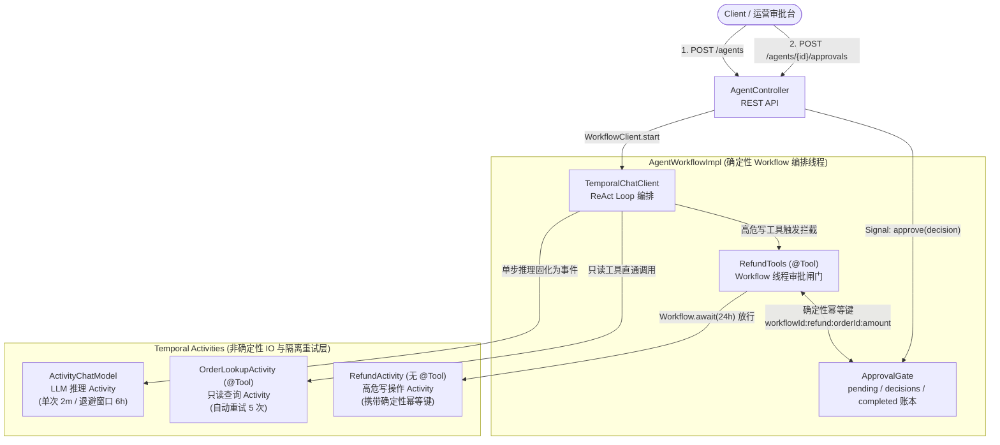
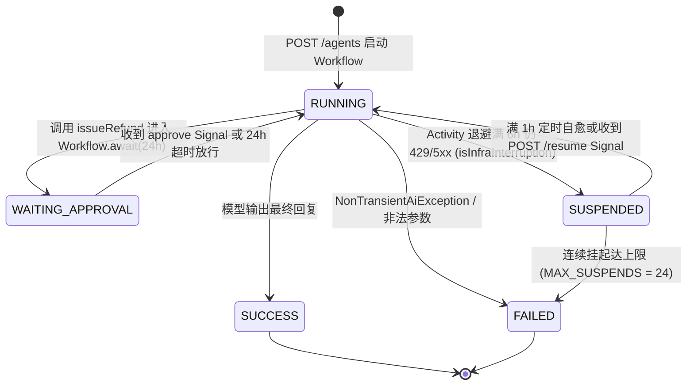
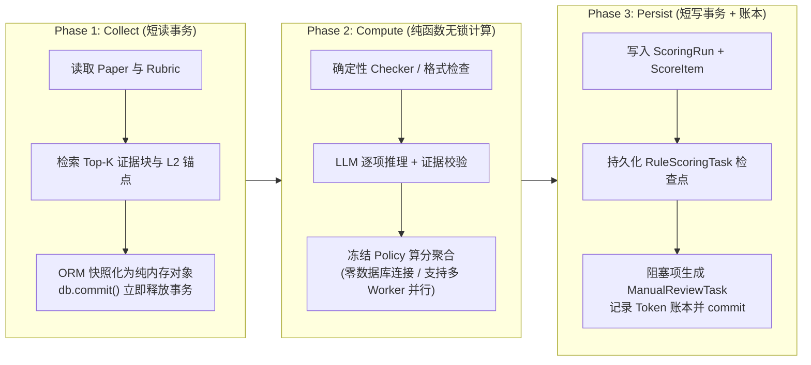

> **导读**：在 Demo 阶段，一个 AI Agent 往往只需要二十行代码——用一个内存里的 `while (hasToolCalls)` 循环把大模型和工具函数串起来即可跑通。但当我们将 Agent 推向真实生产环境时，这种脆弱的进程内循环会迅速撞上分布式系统的铁壁：容器滚动发版导致多步推理状态瞬间清零、高危写操作等待人工审批长达数小时拖垮线程池、上游模型 `429/529` 限流引发工具副作用二次重入、慢速 LLM 网络 I/O 锁死数据库连接池。
>
> 本文将结合我在 GitHub 上的三个开源工程项目——[durable-agent-loop](https://github.com/liuzhne/durable-agent-loop)、[educare-agent-platform](https://github.com/liuzhne/educare-agent-platform) 与 [rubric-audit-engine](https://github.com/liuzhne/rubric-audit-engine)，从底层代码与架构决策出发，系统拆解为什么生产级 Agent 必须引入 **Temporal 持久化执行（Durable Execution）**，并同时在**工具调用层**与**数据库事务层**实施严格的**读写解耦**。

---

## 一、为什么内存里的 `while` 循环在生产环境不可用？

在理解《[Building Effective Agents](/blog/posts/building-effective-agents/)》与《[从 0 到 1 构建 AI Agent](/blog/posts/practical-guide-to-building-ai-agents/)》的架构模式后，很多团队在工程落地时写出的第一版 Agent 运行时往往长这样：

```java
// 典型的脆弱进程内 Agent Loop（反面教材）
@Transactional // 致命隐患 1：在长事务中包裹慢速 LLM 网络调用与多轮循环
public String runNaiveAgent(String userPrompt) {
    List<Message> history = new ArrayList<>(List.of(new UserMessage(userPrompt)));
    while (true) {
        ChatResponse response = chatModel.call(new Prompt(history, toolOptions));
        history.add(response.getResult().getOutput());
        if (!response.hasToolCalls()) {
            return response.getResult().getOutput().getText();
        }
        // 致命隐患 2：只读查询与高危写操作混在同一层，无审批隔离、无幂等账本
        List<Message> toolResults = executeToolsInMemory(response.getToolCalls());
        history.addAll(toolResults);
    } // 致命隐患 3：进程一旦重启，history 与已完成进度全部灰飞烟灭
}
```

这段看似直观的代码，在真实生产环境中会立刻暴露三大工程瓶颈：

### 1.1 进程崩溃与易失状态（Volatile State）

传统的 `while` 循环将对话历史（`history`）与工具执行进度完全存放在 JVM 或 Python 进程内存中。在云原生环境下，Pod 滚动发布、节点缩容、OOM 甚至网络抖动都是常态。一旦进程在第 `N` 轮推理时终止：

- **Token 沉没成本**：前 `N-1` 轮消耗的数万个 Prompt/Reasoning Token 瞬间清零；
- **副作用无法对齐**：如果从头重跑，模型无法感知前一次运行中哪些外部系统状态已经被修改，极易引发重复扣款、重复发信或脏数据写入。

### 1.2 长周期人机协同（Human-in-the-Loop）阻塞与断链

正如我们在《[从 0 到 1 构建 AI Agent](/blog/posts/practical-guide-to-building-ai-agents/)》中所强调的，高风险动作（如资金退款、生产配置变更、高危学生心理干预方案下发）必须引入**人工审批闸门（Human-in-the-Loop, HITL）**。

然而，人工审批的响应时间是分钟级甚至天级（例如 24 小时）的：

- 如果在内存循环中 `Thread.sleep` 或 `CompletableFuture.get` 阻塞等待回调，服务工作线程会被迅速耗尽，且无法跨越进程重启；
- 如果为了规避阻塞，用数据库表手写状态机（比如拆成 `STEP_1_LLM`、`STEP_2_WAIT_APPROVAL`、`STEP_3_RESUME` 三个异步回调方法），原本内聚的 ReAct 循环就会被撕裂成难以维护的状态碎片，上下文恢复与异常分支呈指数级膨胀。

### 1.3 上游基础设施故障（`429/529/5xx`）与数据库长事务锁死

LLM 推理是典型的**高延迟、高抖动外部 I/O**（单次调用耗时数秒至数十秒，且常遇供应商 `429 Rate Limit` 或 `529 Overloaded`）：

- **重试放大副作用**：当第 3 轮模型调用因 `429` 失败时，若在外层简单重试整个 Agent 请求，前 2 轮已经成功执行的工具会被再次触发；
- **长事务拖垮存储层**：如果像上面的反例一样，在同一个数据库事务中边读数据、边调大模型、边写状态，慢速的网络等待会直接锁死 SQLite 的写快照（`BUSY_SNAPSHOT`）或耗尽 PostgreSQL 的连接池，让多 Worker 并发退化为串行排队。

要彻底根治这三大顽疾，我们需要两把手术刀：**用 Temporal 将执行流改造为基于事件溯源的持久化协程**，以及**在工具层与事务层实施彻底的读写解耦**。

---

## 二、引入 Temporal：用事件溯源与确定性重放重构 Agent Loop

在 [durable-agent-loop](https://github.com/liuzhne/durable-agent-loop) 仓库中，我基于 **Spring Boot 3.5**、**Spring AI 1.1.8** 与 **Temporal 1.40（`temporal-spring-ai`）** 构建了一套持久化 AI Agent 运行时。

它的核心设计思想是：**保留开发者熟悉的 `ChatClient` 同步声明式编程体验，但通过 Temporal 的事件溯源（Event Sourcing）与确定性重放（Deterministic Replay），将确定性的工作流编排与非确定性的外部 I/O 彻底剥离。**



### 2.1 单步推理事件化（`ActivityChatModel`）

在传统实现中，`ChatClient` 直接在当前线程发起 HTTP 请求调用 OpenAI 或 Claude；而在 `durable-agent-loop` 中，我们将底层模型包装为 Temporal 的 `ActivityChatModel`：

1. **每次模型调用都是一个独立的 Temporal Activity**：当 ReAct 循环发起第 1 轮推理时，Temporal 将模型的响应报文（包括 `ToolCall` 请求）作为一条不可变事件（`ActivityTaskCompleted`）持久化写入服务端的 Event History。
2. **崩溃后零成本确定性重放**：假设 Worker 进程在第 2 轮工具审批等待期间被 `kill -9` 强制杀死，新启动的 Worker 拉取 Event History 重新执行 `AgentWorkflowImpl#run` 时，`ActivityChatModel` 不会再次向 OpenAI 发起网络请求，而是直接从历史事件中毫秒级返回第 1 轮的模型输出，使代码执行指针瞬间恢复到崩溃前的精确位置。

### 2.2 两级容错隔离：Activity 内退避 vs. Workflow 挂起自愈（`SUSPENDED`）

在生产环境中，我们必须把**参数错误/鉴权失败等不可恢复异常（`NonTransientAiException`）**与**上游限流/区域过载等基础设施中断（`TransientAiException`）**严格区分开来。

首先，在 `application.yaml` 中，我们关闭 Spring AI 自身的内存重试（`max-attempts: 1`），把重试控制权完全移交给 Temporal，并显式将 `429 / 529 / 5xx` 归类为瞬态可重试异常：

```yaml
spring:
  application:
    name: durable-agent-loop
  ai:
    openai:
      api-key: ${OPENAI_API_KEY}
      chat:
        options:
          model: gpt-4o-mini
    retry:
      # 让 Temporal 独占重试控制权：Spring AI 内部只执行一次调用
      max-attempts: 1
      # 默认 4xx 会被归为 NonTransientAiException；显式把 429 / 529 / 5xx 标为 Transient
      on-http-codes: 429,500,502,503,504,529
      exclude-on-http-codes: 400,401,403,404
```

接着，在 `AgentWorkflowImpl.java` 中，我们构建了**"Activity 级指数退避 + Workflow 级挂起自愈"**的两级防线：

```java
public class AgentWorkflowImpl implements AgentWorkflow {

  /** 挂起后每隔 1 小时自动唤醒重试，也支持通过 resume Signal 立即唤醒 */
  private static final Duration AUTO_RESUME_AFTER = Duration.ofHours(1);
  private static final int MAX_SUSPENDS = 24;

  private final ChatClient chatClient;
  private final ApprovalGate gate = new ApprovalGate();
  private State state = State.RUNNING;
  private boolean resumeRequested = false;
  private int suspendCount = 0;
  private String lastError;

  @WorkflowInit
  public AgentWorkflowImpl(AgentRequest request) {
    // 第一级防线：单次推理 Activity 内指数退避重试，最长容忍 6 小时上游故障
    ActivityChatModel model =
        ActivityChatModel.forDefault(
            ActivityOptions.newBuilder(ActivityChatModel.defaultActivityOptions())
                .setStartToCloseTimeout(Duration.ofMinutes(2))
                .setScheduleToCloseTimeout(Duration.ofHours(6))
                .setRetryOptions(
                    RetryOptions.newBuilder()
                        .setInitialInterval(Duration.ofSeconds(5))
                        .setBackoffCoefficient(2.0)
                        .setMaximumInterval(Duration.ofMinutes(10))
                        .setMaximumAttempts(0) // 不限次数，由 6h scheduleToClose 兜底
                        .setDoNotRetry(
                            NonTransientAiException.class.getName(),
                            IllegalArgumentException.class.getName())
                        .build())
                .build());
    // ... 工具注册与 TemporalChatClient 构建
  }

  @Override
  public String run(AgentRequest request) {
    while (true) {
      try {
        state = State.RUNNING;
        String answer = chatClient.prompt().user(request.task()).call().content();
        state = State.SUCCESS;
        return answer;
      } catch (RuntimeException e) {
        if (!isInfraInterruption(e) || suspendCount >= MAX_SUSPENDS) {
          state = State.FAILED;
          lastError = rootMessage(e);
          throw e; // 不可恢复业务异常或挂起超限：直接终止 Workflow
        }
        // 第二级防线：6h 退避仍未恢复（如 API 账户额度耗尽），转入 SUSPENDED 保护现场
        suspendCount++;
        state = State.SUSPENDED;
        lastError = rootMessage(e);
        Workflow.await(AUTO_RESUME_AFTER, () -> resumeRequested);
        resumeRequested = false;
      }
    }
  }
}
```

这套两级机制带来了极强的生产韧性：

1. **Activity 级隔离重试（≤ 6 小时）**：当遇到持续数十分钟的 `429` 限流时，只有当前正在执行的那一次 `ActivityChatModel` 调用在 Temporal 中按指数退避（`5s → 10s → ... → 10m`）重试；**前序已经执行完毕的查询与工具调用静静躺在 Event History 中，绝不会被重复触发**。
2. **Workflow 级挂起自愈（`SUSPENDED`）**：如果企业 API 账户余额耗尽，超过 6 小时仍未恢复，Workflow 不会粗暴报错抛弃用户任务，而是捕获 `isInfraInterruption` 将状态切为 `SUSPENDED`，通过 `Workflow.await` 零线程开销休眠。运维人员充值额度后，只需调用一次 `POST /agents/{id}/resume` 发送 Signal，Agent 即可原地唤醒继续执行。



---

## 三、第一重读写解耦：工具层的"只读直通"与"写操作物理隔离"

很多 Agent 框架教程教大家把业务 Service 的查询方法和写库方法全部加上 `@Tool` 注解，一股脑塞进 `ChatClient`。在生产环境中，这无异于赋予一个概率性生成模型直接操作生产数据库的 root 权限。

在我构建的三个工程仓库中，**工具层的读写解耦（Read-Write Separation at Tool Boundary）**是一条不可妥协的红线：**只读工具可以对模型直通开放，而产生外部副作用的写操作必须与模型物理隔离，并收口到带审批与双层幂等账本的受控通道中。**

### 3.1 只读工具直通：赋予模型充分的上下文探索自由

对于不改变系统状态的只读查询（Read-Only Tools），我们应当让模型自主按需调用：

- 在 [durable-agent-loop](https://github.com/liuzhne/durable-agent-loop) 中，订单查询接口 `OrderLookupActivity` 同时标注了 `@ActivityInterface` 与 `@Tool`：

```java
/** 只读工具：@ActivityInterface + @Tool，模型可直接触发，由 Temporal 托管重试。 */
@ActivityInterface
public interface OrderLookupActivity {

  @Tool(description = "Look up an order's status, amount paid (cents) and refund eligibility.")
  @ActivityMethod
  String lookupOrder(@ToolParam(description = "Order ID") String orderId);
}
```

- 在企业级学生风险预警平台 [educare-agent-platform](https://github.com/liuzhne/educare-agent-platform) 中，这一原则同样贯彻到底：ReAct `AgentLoop` 通过《[Streamable HTTP MCP 协议](/blog/posts/mcp-streamable-http/)》连接的两个 MCP Server（Java 侧 `mcp-student-data` 的 4 个档案/学业/心理/考勤工具，以及 Python 侧 `knowledge-rag` 的 3 个 Milvus 稠密检索工具）**全部被严格限定为只读查询工具**。模型在最多 8 轮的 ReAct 推理中拥有充分的数据探索自由，但**没有任何一个 MCP 工具具备直接修改学生风险等级或下发干预工单的写权限**；只有当 `AgentLoop` 输出结构化结论并经 `FinalAnswerValidator` 校验后，中高风险（`MEDIUM / HIGH`）任务才会由宿主编排器送入独立的 `COMPLIANCE_CHECKING` 合规审核状态机。

### 3.2 高危写工具的物理隔离：为什么 `RefundActivity` 绝不能加 `@Tool`？

回到 `durable-agent-loop` 的退款场景。如果把真正调用支付网关的 `RefundActivity` 挂上 `@Tool`，一旦遭遇 Prompt 注入攻击或模型幻觉，资金就会在未经人工确认的情况下被直接划扣。

为此，我们在代码层面实施了**权限物理隔离**：

```java
/** 真正产生资金副作用的 Activity：故意【不加】@Tool 注解，大模型在 Prompt 层根本无法触达。 */
@ActivityInterface
public interface RefundActivity {

  @ActivityMethod
  String issueRefund(String idempotencyKey, String orderId, long amountCents);
}
```

大模型唯一能看到的，是运行在确定性 Workflow 编排线程上的闸门类 `RefundTools`。当模型决定发起退款时，它调用的是 `RefundTools#issueRefund`：

```java
public class RefundTools {

  private static final Duration APPROVAL_TIMEOUT = Duration.ofHours(24);

  private final ApprovalGate gate;
  private final RefundActivity refundActivity;
  private final String workflowId;
  private final Consumer<State> stateSink;

  @Tool(description = "Issue a refund for an order. Requires human approval before money moves.")
  public String issueRefund(
      @ToolParam(description = "Order ID") String orderId,
      @ToolParam(description = "Refund amount in cents") long amountCents,
      @ToolParam(description = "Short reason shown to the approver") String reason) {

    // 1. 构造确定性业务幂等键（严禁使用 UUID.randomUUID()，否则会破坏 Replay 确定性！）
    String key = workflowId + ":refund:" + orderId + ":" + amountCents;

    // 2. Workflow 账本层幂等检查：若已完成，直接复用历史结果，不二次弹窗、不重跑 Activity
    String done = ApprovalGateAccess.completed(gate).get(key);
    if (done != null) {
      return done;
    }

    // 3. 登记待审批项并切换状态为 WAITING_APPROVAL
    ApprovalGateAccess.pending(gate)
        .putIfAbsent(
            key,
            new PendingApproval(key, "issueRefund", orderId + " / " + amountCents + " cents / " + reason));
    stateSink.accept(State.WAITING_APPROVAL);

    // 4. 零线程开销挂起等待外部 Signal（最长 24 小时）
    boolean decided =
        Workflow.await(APPROVAL_TIMEOUT, () -> ApprovalGateAccess.decisions(gate).containsKey(key));
    stateSink.accept(State.RUNNING);

    if (!decided) {
      ApprovalGateAccess.pending(gate).remove(key);
      return "Refund NOT executed: approval timed out after 24h.";
    }

    ApprovalDecision d = ApprovalGateAccess.decisions(gate).get(key);
    ApprovalGateAccess.pending(gate).remove(key);

    // 5. 仅在人工批准后，才由 Workflow 显式触发底层 RefundActivity
    String result;
    if (!d.approved()) {
      result = "Refund REJECTED by " + d.approver() + ": " + d.comment();
    } else {
      String refundId = refundActivity.issueRefund(key, orderId, amountCents);
      result = "Refund executed. refundId=" + refundId + ", approvedBy=" + d.approver();
    }
    ApprovalGateAccess.completed(gate).put(key, result);
    return result;
  }
}
```

### 3.3 跨越重放与重试的双层幂等设计

仔细观察上面的 `RefundTools` 与 `RefundActivityImpl`，你会发现高危写操作之所以能做到"万无一失"，依赖的是**两层不同维度的幂等保障**：

| 幂等层级 | 所在位置 | 解决的故障场景 | 核心实现机制 |
| :--- | :--- | :--- | :--- |
| **第一层：Workflow 账本幂等** | `ApprovalGate.completed` (`LinkedHashMap`) | Workflow 因 `SUSPENDED` 挂起后重新发起 `chatClient.prompt()`，模型再次请求同一笔退款 | 用纯业务参数构造确定性键 `workflowId:refund:orderId:amountCents`，命中 `completed` 直接短路返回，**不二次打扰审批人、不重复调度 Activity** |
| **第二层：Activity 网关幂等** | `RefundActivityImpl` / 下游唯一索引 | Worker 在"支付网关扣款成功"与"向 Temporal 报告 Activity 完成"之间的毫秒级窗口内崩溃，触发 Temporal `At-Least-Once` 重试 | 将同一个 `idempotencyKey` 透传给下游支付接口的 `Idempotency-Key` 请求头或本地表 `refunds(idempotency_key UNIQUE)`，实现真正的 **Exactly-Once** |

> **工程避坑指南**：在 `RefundTools` 中生成幂等键时，**绝对不能使用 `UUID.randomUUID()` 或 `System.currentTimeMillis()`**！因为 `RefundTools` 运行在 Temporal 的确定性 Workflow 线程上，崩溃重放（Replay）时若生成了新的随机 UUID，会导致状态账本失配并触发 `NonDeterministicException`。用纯业务参数拼接的确定性 Key，才是连接重放、外层重新 Prompt 与下游幂等的唯一锚点。

---

## 四、第二重读写解耦：数据库事务层的 `collect → compute → persist`

除了工具调用边界上的读写分离，生产级 Agent 系统在**自身的数据持久化与批处理编排**上，还面临另一重极易被忽视的读写耦合陷阱：**把慢速的 LLM 推理包在数据库事务里。**

在多租户量规驱动文档审计与评分引擎 [rubric-audit-engine](https://github.com/liuzhne/rubric-audit-engine) 中，评估一篇毕业论文或技术方案需要经历"确定性格式/结构检查 → 篇章语义一致性分析 → 逐评分项检索证据块与 L2 校准锚点 → 多次 LLM 结构化判分 → 策略汇总与人工复核派单"。整套流程单篇耗时可达十余秒。

### 4.1 为什么"边读库、边调模型、边写库"会拖垮并发？

早期如果在一个 SQLAlchemy `Session` 事务中直接跑完整个评分流：

1. **SQLite 本地/CLI 并发死锁**：`rubric-audit-engine` 提供了零服务本地命令行端 `pgs score --workers N`。若 Worker 线程在持有数据库读快照或写事务期间发起长达 10 秒的 LLM 调用，其它完成计算的 Worker 在尝试写入结果时会立刻撞上 SQLite 的 `BUSY_SNAPSHOT` / `database is locked` 错误。
2. **PostgreSQL 生产连接池枯竭**：在生产环境的批量评分队列（`work_queue`）中，长事务会长时间占用宝贵的数据库连接（如 Supabase / PgBouncer 事务池连接），甚至因 `idle_in_transaction_session_timeout` 被数据库服务端强制断开，导致已消耗的 LLM 推理结果无法落库。

### 4.2 架构决策 `D-009`：三段式 `collect → compute → persist` 解耦

为了彻底解除慢速 LLM 计算与数据库事务的耦合，我们在 [rubric-audit-engine](https://github.com/liuzhne/rubric-audit-engine) 的架构决策 `D-009`（详见仓库 `DECISIONS.md` 与 `backend/app/services/scoring/engine.py`）中，将评分引擎重构为严格的**三阶段读写分离管线**：



对应的核心编排代码位于 `backend/app/services/scoring/engine.py`：

```python
def _score_paper_legacy(db: Session, paper_id: str, scorer):
    paper = _load_scoreable_paper(db, paper_id)
    started_at = _utcnow()

    # Phase 1 (Collect)：一次性预取全部评分输入，并将 ORM 实体快照为纯内存对象
    inputs = collect_scoring_inputs(db, paper)

    # 关键边界：立即结束并释放事务！纯计算阶段绝不持有任何数据库锁或快照
    db.commit()

    # Phase 2 (Compute)：纯函数计算（所有慢速 LLM 调用在此发生，零 DB 依赖）
    result = compute_scoring(inputs, scorer)

    # Phase 3 (Persist)：计算完成后开启毫秒级短写事务，一次性落库
    return persist_scoring(db, paper_id, inputs, result, scorer, started_at)
```

为了防止 `compute_scoring` 在事务释放后不小心触发 SQLAlchemy 的延迟加载（`DetachedInstanceError`），我们在 `collect_scoring_inputs` 中通过 `_snapshot_criterion` 将 ORM 实体彻底剥离为纯内存的 `SimpleNamespace` 与不可变数据类 `ScoringInputs`：

```python
@dataclass
class CriterionPlan:
    """单个评分项的"计算计划"：评分项快照 + 预取的证据候选/校准锚点（compute 阶段不再碰 DB）。"""
    criterion: SimpleNamespace
    route: str  # findings | deterministic | hybrid | chunks
    candidates: list = field(default_factory=list)
    anchors: list = field(default_factory=list)
    sub_plans: list = field(default_factory=list)
```

### 4.3 读写解耦带来的三大架构红利

当我们将 `compute_scoring` 锤炼成完全不碰数据库的纯函数后，收获了三个意想不到的工程红利：

1. **多 Worker 真正无锁并行**：在 CLI `pgs score --workers 8` 模式下，8 个并发线程在漫长的 LLM 推理阶段互不阻塞，仅在末尾毫秒级的 `persist_scoring` 阶段顺序写入，吞吐量随并发度线性提升。
2. **解锁零数据库的无状态模式（`--no-db`）**：因为 `compute_scoring` 只认内存里的 `ScoringInputs`，我们只写了一个百余行的 `collect_inputs_from_parsed()` 适配器，就直接让 CLI 支持了 `pgs score 论文.docx --no-db --rubric-file 规则.xlsx`——**不建 SQLite、不落任何表，从文件直接算分输出 JSON**，完美适配隐私敏感或 CI 临时脚本场景。
3. **规则级决策账本与阻塞式人工复核（架构决策 `D-016`）**：在 Core 引擎路径（`_score_paper_core`）中，我们将规则级输出与异常检查点写入 `RuleScoringTask` 与 `rule_decision_ledger`。当某条语义规则因上游故障或证据不足产生阻塞级无效结果（`blocking invalid`）时，系统不会让整篇文档评分崩溃重来，而是保留其它已完成规则的分数，自动为失败项生成一条 `ManualReviewTask`，并严格维持 `final_total_score = None`（Fail-Closed），直到人工复核员领取任务并引用冻结的 `DocumentSnapshot` 原文证据完成定分。

---

## 五、总结：生产级 Agent 的三条架构铁律

回顾 [durable-agent-loop](https://github.com/liuzhne/durable-agent-loop)、[educare-agent-platform](https://github.com/liuzhne/educare-agent-platform) 与 [rubric-audit-engine](https://github.com/liuzhne/rubric-audit-engine) 三个项目的演进过程，我们可以将"从 Demo 级 Loop 走向生产级 Agent"的工程经验浓缩为以下对照表：

| 工程维度 | 玩具级 Agent (`while` 循环) | 生产级 Agent（Temporal + 读写解耦） | 对应开源仓库参考实现 |
| :--- | :--- | :--- | :--- |
| **执行状态与崩溃恢复** | 对话历史保存在进程内存，滚动发版或 OOM 即全盘丢失 | 基于 Temporal Event Sourcing，单步推理事件化，崩溃后毫秒级确定性重放 | `durable-agent-loop` (`AgentWorkflowImpl` / `ActivityChatModel`) |
| **上游限流与长尾容错** | 简单重试整个请求，导致前序工具重复执行或直接抛错失败 | 两级容错：Activity 内指数退避（6h 窗口）+ Workflow 级 `SUSPENDED` 挂起自愈 | `durable-agent-loop` (`isInfraInterruption` / `Workflow.await`) |
| **工具层读写权限边界** | 查询与写操作全部挂 `@Tool` 暴露给模型，易受幻觉或注入攻击 | **读写物理隔离**：只读查询（MCP/Activity）直通模型；高危写操作摘除 `@Tool`，收口至审批闸门 | `durable-agent-loop` (`RefundTools` vs `RefundActivity`)、`educare-agent-platform` (只读 MCP + 合规审核) |
| **人机协同（HITL）与幂等** | 阻塞工作线程或手写碎片化回调状态机；使用随机 UUID 导致重放失败 | `Workflow.await` 零线程开销挂起等待 Signal；基于纯业务参数的双层幂等账本 | `durable-agent-loop` (`ApprovalGate` + `RefundActivityImpl`) |
| **数据库事务与并发计算** | 在长事务中发起慢速 LLM 网络 I/O，引发锁冲突与连接池耗尽 | **`collect → compute → persist` 三段式解耦**：短读预取快照、纯函数无锁推理、短写落库与规则账本 | `rubric-audit-engine` (`engine.py` / ADR `D-009` & `D-016`) |

大模型赋予了软件系统前所未有的泛化推理能力，但**模型越是概率性的，包裹它的工程外壳就越必须是确定性的**。用 Temporal 驯服长周期状态与分布式故障，用工具层与事务层的双重读写解耦守住安全与并发底线——这正是让 AI Agent 真正敢于接管核心生产业务的工程基石。

---

## 参考与源码仓库

- **[liuzhne/durable-agent-loop](https://github.com/liuzhne/durable-agent-loop)**：基于 Spring Boot 3、Spring AI 1.1 与 Temporal Workflow 构建的高容错、支持人机协同（Human-in-the-Loop）的持久化 AI Agent 运行时。
- **[liuzhne/educare-agent-platform](https://github.com/liuzhne/educare-agent-platform)**：基于 Spring AI ReAct AgentLoop、双栈 Streamable HTTP MCP Server 与 Milvus 稠密检索构建的企业级风险评估与智能干预平台。
- **[liuzhne/rubric-audit-engine](https://github.com/liuzhne/rubric-audit-engine)**：基于 FastAPI 与 PostgreSQL RLS 的多租户、量规驱动（Rubric-driven）文档审计与结构化评测引擎（详见下一篇《[从 0 到 1 构建基于 QWK 的 Agent 自动化发布门禁](/blog/posts/agent-qwk-release-gate-from-zero-to-one/)》）。
